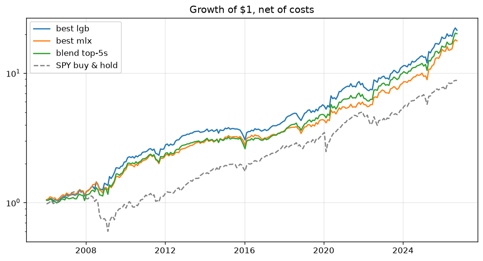

# quant: ML stock ranking on Apple Silicon, tested honestly

[](https://github.com/vendraholdings/quant/actions/workflows/tests.yml)


Every night this project downloads S&P 500 data, builds features, and searches **~2,000 machine-learning models**:
LightGBM runs on the CPU and MLX neural nets run on the Apple GPU at the same time. Each model trades a monthly
long-short portfolio, and the best one is then tested for **whether it beats luck**.

Most backtests on GitHub stop at "look, a high Sharpe". This one asks how much of that Sharpe is just from
trying 2,000 models, and answers with the **Deflated Sharpe Ratio** and a **1,000,000-sample GPU bootstrap**.

## Results (latest overnight run)



| strategy | Sharpe (after costs) | CAGR (after costs) | max drawdown | mean IC |
|---|---|---|---|---|
| best LightGBM | 1.02 | 15.9% | -19.7% | 0.039 |
| best MLX MLP | 1.03 | 14.9% | -17.2% | 0.039 |
| blend of top-5s | 1.00 | 15.6% | -18.7% | 0.040 |

**Is it real?**
- **Deflated Sharpe probability: 99.9%.** The best Sharpe you would expect from 1,979 strategies with no skill is 0.43, and the winner's 1.03 clears it comfortably.
- **Block bootstrap, 1M resamples on the GPU in 0.2 s:** the 90% interval for Sharpe is 0.74 to 1.29, and P(Sharpe ≤ 0) ≈ 0.

**Known bias:** this run uses *today's* S&P 500 members, so companies that went bust or were removed are
missing, which flatters returns. The fix is already built: a point-in-time membership filter (which stocks
were in the index on each date, since 2000), tested in `tests/`. Its results replace this table after the next overnight run.
Full report: [`reports/overnight.md`](reports/overnight.md).

## How it works

```
prices (yfinance)  ─────────────► 14 features per stock-day ─► rank-normalise per date
   momentum 1w..12m, 12-1 mom, volatility, 52w-high, max-return, skew, liquidity, size, volume surge
                                     │
                    walk-forward: refit every year on all past data
                    40-day embargo between train and test (no look-ahead)
                                     │
        ┌────────────────────────────┴────────────────────────────┐
  LightGBM random search (CPU, multi-process)       MLX MLP random search (GPU)
        └────────────────────────────┬────────────────────────────┘
          long top 10% / short bottom 10%, rebalance every 21 days, 10 bps per side
                                     │
          Deflated Sharpe  ·  GPU block bootstrap  ·  equity curve vs SPY
```

- **Target:** each stock's next-21-day return, ranked against the other stocks on the same date (a cross-sectional rank).
- **No leakage:** yearly expanding-window refits, with a 40-calendar-day gap so no training target overlaps the test year. A unit test proves it.
- **Costs:** turnover-based, 10 bps per side, charged on both legs.
- **Search:** resume-safe random search that runs until a deadline, with results streamed to JSONL so a crash loses nothing.

## In progress: earnings edge

- **Event study** ([`earnings_study.py`](src/quant/research/earnings_study.py)): earnings-day moves, and post-earnings drift by EPS-surprise quintile.
- **Straddle pricing:** the break-even implied-move markup, from a GPU bootstrap.
- **Earnings features for the ranker:** days to/since earnings, last surprise, last move. Joined *as-of* the date the reaction was complete, never earlier, with a unit test.
- **A/B test:** the same model search with and without earnings features, on the point-in-time universe.
- **Daily option-chain snapshots** for 40 liquid names ([`options_snap.py`](src/quant/data/options_snap.py)). Free historical implied-vol data doesn't exist, so this builds its own.

## Run it

```bash
uv sync                                                    # Python 3.12, Apple Silicon (MLX)
uv run pytest -q                                           # correctness + leakage tests
uv run python -m quant.data.universe                       # S&P 500 tickers
uv run python -m quant.data.prices --tickers-file config/sp500.txt --start 2000-01-01
uv run python -m quant.research.xsec panel                 # feature panel (Parquet)
uv run python -m quant.research.xsec sweep --model lgb --deadline $(( $(date +%s) + 3600 )) --workers 6 --threads 4
uv run python -m quant.research.xsec report                # reports/overnight.md + chart
```

`scripts/overnight.sh` chains everything into a single unattended night run, with a hard stop time.

## Stack

polars (lazy, as-of joins) · LightGBM · MLX (Apple GPU) · NumPy/SciPy · DuckDB/Parquet · yfinance · uv

## Layout

```
src/quant/data/       prices, S&P universe + historical membership, earnings dates, option snapshots
src/quant/research/   xsec.py (features, walk-forward, backtest, Deflated Sharpe, bootstrap), earnings_study.py
scripts/              overnight runners
tests/                leakage, costs, point-in-time and Deflated Sharpe tests
reports/              generated results
```

Research code, not investment advice.
