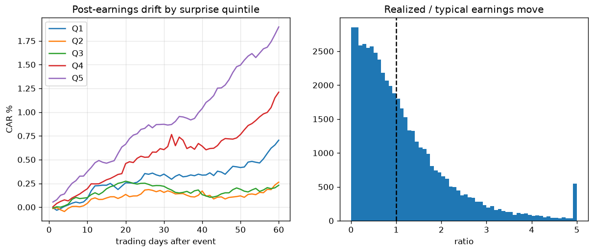

# Earnings event study

53,531 reported earnings events, 662 tickers, 2001-01-11 -> 2026-08-20. Window close(t-1)->close(t+1), abnormal = minus SPY.

## How big are earnings moves?

- median |abnormal move| 3.27%, mean 4.70%, 95th pct 14.07%
- realized / typical (prior 8 events): median 0.85, share > 2x typical 15.1% (fat tails = short-straddle blowups)

## Post-earnings drift by surprise quintile (abnormal return after the window)

| quintile | events | +20d | t | +60d | t |
|---|---|---|---|---|---|
| Q1 | 10,554 | 0.26% | 2.5 | 0.70% | 3.8 |
| Q2 | 10,593 | 0.13% | 2.0 | 0.26% | 2.1 |
| Q3 | 10,610 | 0.27% | 4.2 | 0.23% | 2.0 |
| Q4 | 10,599 | 0.46% | 5.6 | 1.21% | 5.5 |
| Q5 | 10,636 | 0.66% | 6.9 | 1.90% | 10.1 |

Q5 minus Q1 at +60d: **1.19%** (before costs). Drift by era:

| era | Q5-Q1 +60d |
|---|---|
| 2001-2007 | 2.59% |
| 2008-2013 | -0.61% |
| 2014-2019 | 0.65% |
| 2020-2026 | 2.10% |

## Straddles: what implied move would have made them fair?

Premium = markup x the stock's typical earnings move; return held over the event window (ignores bid/ask and vega after the event). 1,000,000 random 50-event books per markup, bootstrapped on the GPU with MLX in 0.4s.

| markup | long straddle mean | 5%..95% (50-event book) | P(long book wins) |
|---|---|---|---|
| 0.6x | +87.4% | +48.6% .. +131.6% | 100% |
| 0.7x | +60.6% | +27.3% .. +98.4% | 100% |
| 0.8x | +40.5% | +11.4% .. +73.6% | 99% |
| 0.9x | +24.9% | -0.9% .. +54.3% | 94% |
| 1.0x | +12.4% | -10.9% .. +38.8% | 79% |
| 1.1x | +2.2% | -19.0% .. +26.3% | 54% |
| 1.2x | -6.3% | -25.7% .. +15.7% | 29% |
| 1.3x | -13.5% | -31.4% .. +6.9% | 13% |
| 1.4x | -19.7% | -36.4% .. -0.8% | 4% |
| 1.5x | -25.0% | -40.6% .. -7.4% | 1% |
| 1.6x | -29.7% | -44.3% .. -13.2% | 0% |
| 1.7x | -33.9% | -47.6% .. -18.3% | 0% |
| 1.8x | -37.5% | -50.5% .. -22.8% | 0% |

Break-even markup ~ **1.1x**: if options price the earnings move above this, selling straddles had positive expectancy (with fat-tail risk); below it, buying them did. Next step: compare with real implied moves from the daily option snapshots (data/options).

