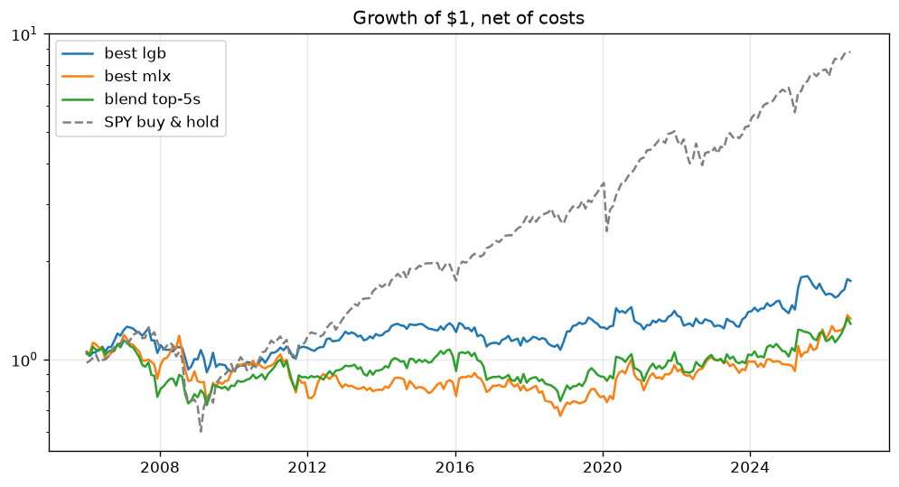

# Overnight cross-sectional ML run

Trials: 2613 (863 LightGBM, 1750 MLX MLP). Universe: current S&P 500 members (survivorship-biased: delisted names missing, so absolute returns are flattering). Long top / short bottom decile, 21-day rebalance, 10 bps per side.

## Headline

| strategy | Sharpe net | Sharpe gross | CAGR net | max DD net | mean IC |
|---|---|---|---|---|---|
| best lgb | 0.29 | 0.57 | 2.7% | -27.6% | 0.0165 |
| best mlx | 0.17 | 0.37 | 1.4% | -43.6% | 0.0149 |
| blend top-5s | 0.16 | 0.38 | 1.2% | -36.6% | 0.0186 |

## Is the best one real? (best lgb)

- Deflated Sharpe probability: **38.4%** (expected best-of-2613 Sharpe by pure luck: 0.35)
- Block-bootstrap Sharpe (1M resamples on GPU in 0.1s): 5% -0.06, median 0.25, 95% 0.56; P(Sharpe <= 0) = 9.3%

## Top 10 configs

| model | id | Sharpe net | IC | IC IR | maxDD | secs |
|---|---|---|---|---|---|---|
| lgb | 094a78357a | 0.29 | 0.0165 | 0.55 | -27.6% | 85.3 |
| lgb | fbb56c6400 | 0.28 | 0.0131 | 0.42 | -27.3% | 345.0 |
| lgb | e13944edfa | 0.26 | 0.0159 | 0.56 | -26.8% | 786.1 |
| lgb | 28fa6c9106 | 0.26 | 0.0161 | 0.49 | -25.6% | 219.6 |
| lgb | f45d4738f4 | 0.25 | 0.0153 | 0.51 | -31.8% | 188.0 |
| lgb | 54a2642cb4 | 0.22 | 0.0133 | 0.41 | -27.3% | 204.9 |
| lgb | 05a39c3ca5 | 0.22 | 0.0149 | 0.46 | -25.6% | 33.1 |
| lgb | d909a06b25 | 0.22 | 0.0148 | 0.49 | -25.7% | 407.7 |
| lgb | 6dbf9a3ed4 | 0.21 | 0.0151 | 0.47 | -28.8% | 168.9 |
| lgb | 371ef718a0 | 0.20 | 0.0143 | 0.45 | -24.2% | 630.3 |

## Best configs

- lgb `094a78357a`: `{"lr": 0.1, "leaves": 7, "min_leaf": 2000, "ff": 0.9, "bf": 0.5, "l2": 0, "trees": 600, "obj": "regression", "seed": 5162, "id": "094a78357a"}`
- lgb `fbb56c6400`: `{"lr": 0.02, "leaves": 127, "min_leaf": 100, "ff": 0.9, "bf": 0.9, "l2": 100, "trees": 300, "obj": "regression", "seed": 4054, "id": "fbb56c6400"}`

