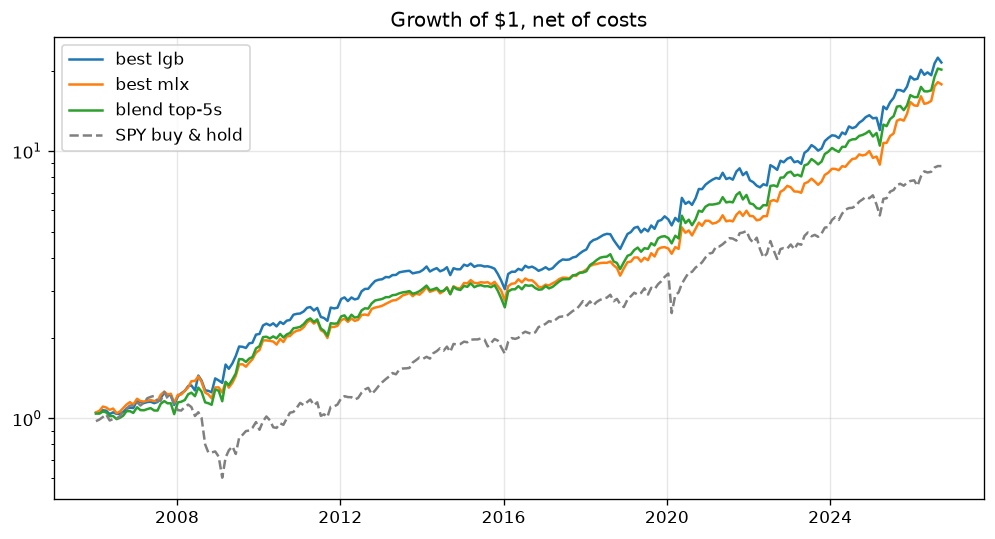

# Overnight cross-sectional ML run

Trials: 1979 (758 LightGBM, 1221 MLX MLP). Universe: current S&P 500 members (survivorship-biased: delisted names missing, so absolute returns are flattering). Long top / short bottom decile, 21-day rebalance, 10 bps per side.

## Headline

| strategy | Sharpe net | Sharpe gross | CAGR net | max DD net | mean IC |
|---|---|---|---|---|---|
| best lgb | 1.02 | 1.18 | 15.9% | -19.7% | 0.0390 |
| best mlx | 1.03 | 1.21 | 14.9% | -17.2% | 0.0387 |
| blend top-5s | 1.00 | 1.15 | 15.6% | -18.7% | 0.0396 |

## Is the best one real? (best mlx)

- Deflated Sharpe probability: **99.9%** (expected best-of-1979 Sharpe by pure luck: 0.43)
- Block-bootstrap Sharpe (1M resamples on GPU in 0.2s): 5% 0.74, median 1.01, 95% 1.29; P(Sharpe <= 0) = 0.0%

## Top 10 configs

| model | id | Sharpe net | IC | IC IR | maxDD | secs |
|---|---|---|---|---|---|---|
| mlx | 41e95d914b | 1.03 | 0.0387 | 0.92 | -17.2% | 37.5 |
| mlx | 6f096fa0d0 | 1.03 | 0.0384 | 0.93 | -17.8% | 15.6 |
| lgb | 2b100cee76 | 1.02 | 0.0390 | 0.94 | -19.7% | 21.4 |
| lgb | 846d2e00af | 1.01 | 0.0386 | 0.94 | -19.4% | 34.9 |
| lgb | 3a9a142912 | 1.00 | 0.0377 | 0.95 | -21.6% | 18.5 |
| mlx | 74be4c521b | 1.00 | 0.0387 | 0.91 | -18.5% | 18.2 |
| mlx | ac38af7b45 | 1.00 | 0.0397 | 0.93 | -18.5% | 14.5 |
| mlx | dfdf75e4ae | 1.00 | 0.0385 | 0.92 | -16.6% | 23.0 |
| mlx | fc1b69b9d8 | 0.99 | 0.0395 | 0.91 | -19.7% | 20.4 |
| lgb | 0eb1defa25 | 0.99 | 0.0378 | 0.93 | -20.6% | 10.4 |

## Best configs

- mlx `41e95d914b`: `{"hidden": 64, "depth": 3, "dropout": 0.0, "lr": 0.0003, "wd": 0.01, "epochs": 5, "batch": 1024, "seed": 9838, "id": "41e95d914b"}`
- mlx `6f096fa0d0`: `{"hidden": 512, "depth": 2, "dropout": 0.3, "lr": 0.001, "wd": 0.0, "epochs": 5, "batch": 4096, "seed": 2976, "id": "6f096fa0d0"}`

